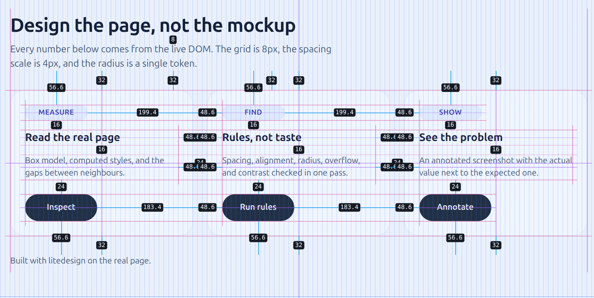

# litedesign

Grid, gap, and alignment on the real web page — plus an MCP bridge
so an agent can read the live DOM and fix it.



Every number in the image above comes from the page as it is right now: the grid
is 8px, the spacing scale is 4px, and the radius is one token. Nothing is
exported, imported, or redrawn in a canvas. The overlay is injected into the
page you already have open, lives in a closed shadow root, and never touches
layout.

## What you get

- **Overlay layers** — `grid` (8px), `guide` (alignment edges and centers),
  `gap` (distance labels between neighbours), `issue` (rule violations),
  `hover` (box model of the element under the cursor).
- **Rules** — `spacing-scale`, `alignment-near-miss`, `radius-consistency`,
  `overflow`, `contrast`. Each rule is one file and one reason to change.
- **MCP tools** — an agent can open the page, measure a selector, list issues,
  capture the viewport, annotate it, and draw the overlay without asking you to
  click anything.

## Requirements

- Node.js 20 or newer.
- Chrome or Chromium. The extension is unpacked, so it is loaded from a folder
  instead of the Web Store.
- Optional: `playwright-core` in the MCP server's environment. With it, the
  agent can open pages by itself instead of using the tab you have open.

## Install

```bash
npm i -g @rahmantech/litedesign
litedesign setup
```

`setup` copies the extension into `~/.litedesign/extension`, writes
`~/.litedesign/config.json` (`{ "port": 8787, "mode": "auto" }` the first time),
and prints the next section of this README.

Check everything at once:

```bash
litedesign doctor
```

## Load the extension into Chrome

Chrome forbids installing an extension programmatically, so this is the one
manual step, and you only do it once:

1. Open `chrome://extensions`.
2. Turn on **Developer mode** (top right).
3. Click **Load unpacked** and pick the folder litedesign prints —
   `~/.litedesign/extension`.

To print the folder again:

```bash
litedesign extension path
```

After upgrading the package, refresh the loaded copy with:

```bash
litedesign extension update   # re-copies the folder
```

then press **Reload** on the litedesign card in `chrome://extensions`.

## Use it on a page

Open any `http(s)` page, then click the litedesign icon. The popup shows the
bridge status and two actions:

| Action           | What it does                                             |
| ---------------- | -------------------------------------------------------- |
| Watch this tab   | binds this tab as the page the agent measures            |
| Toggle overlay   | turns the grid, guides, gap labels, and issues on or off |

The overlay state (on/off and which layers) is stored in the extension, so a
page reload no longer clears it.

The bridge is a standalone daemon, not a child of the agent session:

```bash
litedesign ws start     # start it in the background
litedesign ws status    # is it up, on which port, which pages
litedesign ws stop      # stop it
```

The MCP server starts the daemon on its own when none is running, so these
commands are for checking and for running the bridge before the agent does.

## Connect an MCP client

The server speaks MCP over stdio:

```json
{
  "mcpServers": {
    "litedesign": {
      "command": "litedesign",
      "args": ["mcp"]
    }
  }
}
```

OpenCode uses a different shape:

```json
{
  "mcp": {
    "servers": {
      "litedesign": {
        "type": "local",
        "command": ["litedesign", "mcp"]
      }
    }
  }
}
```

If a client was already running when you upgraded litedesign, its MCP connection
still points at the old process. Reload the client configuration (in OpenCode:
`opencode reload`) or restart the client.

### Tools

| Tool                   | What it returns                                             |
| ---------------------- | ----------------------------------------------------------- |
| `capabilities`         | version, drivers, mode, connected pages, valid rule names   |
| `inspect`              | tree summary and a screenshot; opens and keeps the page     |
| `await_page`           | waits for the page from `inspect` to connect                |
| `measure`              | box model, computed styles, and gaps for one selector       |
| `find_issues`          | rule violations with selector, actual, expected, severity   |
| `screenshot`           | PNG of the viewport, or of one element                      |
| `screenshot_annotated` | PNG with grid, guides, gaps, and issue labels               |
| `overlay`              | shows or hides the layers; answers with what the page shows |

Call `inspect` first. It opens the page and keeps it alive for the other tools.

## Drivers

The MCP server picks a driver automatically:

| Driver       | Who opens the page | Needs                                     |
| ------------ | ------------------ | ----------------------------------------- |
| `playwright` | the agent          | `playwright-core` installed               |
| `extension`  | you                | Chrome open with the extension loaded     |

With the extension driver nothing is launched: the agent measures the tab you
are looking at. Full-page screenshots need the Playwright driver; the extension
captures the visible viewport.

## Configuration

`~/.litedesign/config.json`:

```json
{
  "port": 8787,
  "mode": "auto"
}
```

- `port` — the WebSocket port shared by the daemon and the extension. The
  extension reads the same value from its own `config.json`, which `setup`
  writes.
- `mode` — `auto` (prefer Playwright, fall back to the extension),
  `playwright`, or `extension`.
- Bridge state is per port: `~/.litedesign/ws-<port>.json` holds the pid, so
  stopping a bridge on one port never disturbs another.

## Commands

```bash
litedesign setup              # scaffold extension + config
litedesign extension path     # print the folder to load unpacked
litedesign extension update   # re-copy the extension after an upgrade
litedesign doctor             # check node, extension, config, and port
litedesign ws start           # start the bridge in the background
litedesign ws stop            # stop the bridge
litedesign ws status          # show the bridge and connected pages
litedesign mcp                # start the MCP server (stdio)
```

## Development

```bash
pnpm install
pnpm build          # core, extension, cli
pnpm test           # build + vitest
pnpm typecheck
pnpm lint
pnpm fixtures       # dev server on http://127.0.0.1:4173
```

Open <http://127.0.0.1:4173/fixtures/design.html>. The fixture server injects a
small mtime poller into every HTML it serves, so saving a fixture reloads the
page in Chrome without a manual refresh. Only the fixture server does this;
pages you visit yourself are never injected.

The repository is a pnpm workspace with three packages:

| Package                | Responsibility                                       |
| ---------------------- | ---------------------------------------------------- |
| `packages/core`        | measures the DOM: graph, gaps, rules, overlay render |
| `packages/extension`   | injects the overlay, owns the tab, talks to the hub  |
| `packages/cli`         | installs the extension and exposes the MCP server    |

`core` measures and never stores or renders other people's pages. `extension`
injects and displays and never edits source. `cli` installs and exposes and
never owns measurement logic.

## License

Apache License 2.0. See [LICENSE](LICENSE).
